# 1.Introducton to “attention” in transformer
## 1.1background

In 2014, many researchers were dedicated to machine translation, such as translating English into French. Early methods involved extracting English words one by one, looking up their corresponding French vocabulary in a dictionary or table, and converting them directly. However, this approach performed poorly for a variety of reasons—such as differences in word order and sentence length between English and French. 

To address this issue, research teams from the University of Montreal and Stanford University introduced the attention mechanism. Both teams found that the encoder-decoder framework yielded remarkable results for translation tasks.The early workflow operated roughly as follows: an encoder (RNN) read the input word by word to generate a single dense vector that represented the semantics of the entire sentence(As a word is read, the model updates and generates the hiddien state vector $h_t$ for the current time step). But in these new papers, the vectors from each individual word were preseverd and made avaliable to the decoder(RNN). These dense per-word vectors captured the meaning of words in the context of sentence. Today we call this contextual embeddings, when the embedding depends not just the word, but also on the words around it. Once the input sentence is converted into a vector, the decoder will use the vector as input and then generate the output(decoder generate one word at a time). The key of above process is that the decoder has a waiting mechanism, or we also say paying attention to  each input word. The waiting mechanism give us the early form of attention. 

In 2017, "Attention is All You Need" introduced transformer and a more general form of attention, which was specifically designed to be highly scalable using GPUs. When the authors designed this architecture, the No.1 criteria for a lot of design choices was, can they scale this on GPUs? 
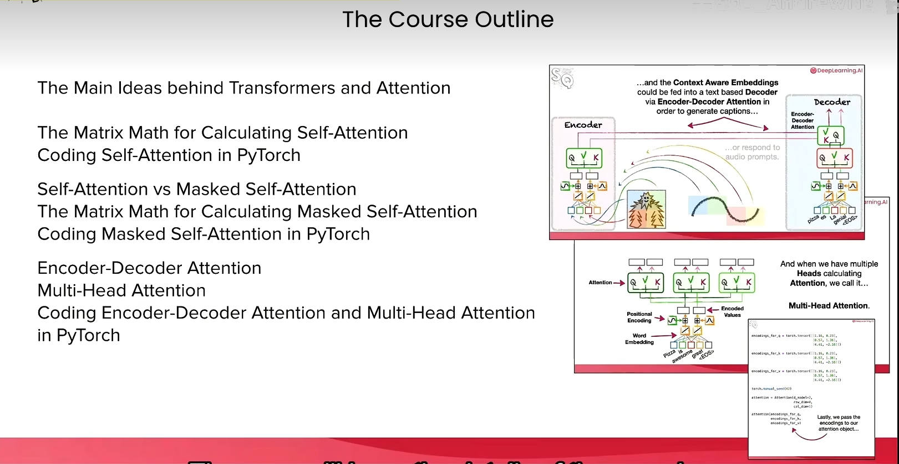

# 2.The Main Ideas behind Transformers and Attention
Transformer requires three main blocks: Word Embedding、 Position Encoding and Attention.
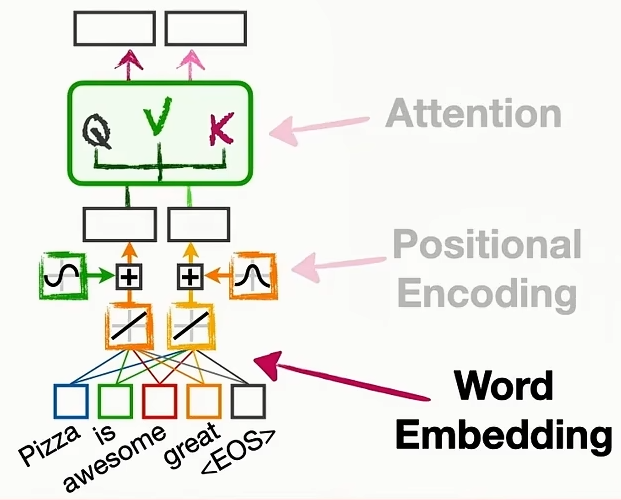
1. Word Embedding: translate the input sentence into a digital sequence.
2. Position Encoding: helps keep track of word order. Two sentences which have the exact same words may have totally different meanings, if the same word is not in the same position.
e.g.:  "Niko likes Pizza" vs "Pizza likes Niko"
3. Attention: Transformer  can establish relationship between words with attention.
For exmple, the word "it" in the sentence "The pizza came out the oven and it tasted good" could represent both "pizza" and "oven"(If we neglect the meaning of the sentence). But if we take the meaning of the sentence into considerarion, we'll know that "it"  must represent "pizza". It's a good news that transformer has something called attention, which is a mechanism to correctly associate "it" with "pizza".
Note: There are many kinds of attention, and we will begin from the most basic one. self-attention.  In short, self-attention works by seeing how similar each word is to all other words(include itself) in the sentence(every words in the sentence will undergo this process). Once the similarity is calculated, they are used to determine how transformer encodes each word. For example, if you looked at a lot of sentences about pizza and the word "it" more commomly associated with pizza than oven, than the similarity score for pizza will cause it have a larger impact on how the word "it" is encoded by transformer.

In summary, Word Embedding converts the word into numbers. Positional Encoding helps keep track of word order. Attention helps calculate the similarity between each word.

# 3. The Matrix Math For Calculatiing Self-Attention 
The equation for calculating Self-Attention:
$$Attention = softmax(\frac{QK^T}{\sqrt{d_k}})V$$
Where Q stands for Query, K stands for Key, V stands for Value, $d_k$ stands for the dimension of the K, and they comes from datebase terminology. Let's talk about database first.
Imaging we had a database of guests at a hotel:
|Last Name|Room Number|
|---|---|
|Niko|2001|
|Niken|3009|
|Nancy|7881|
|...|...|
Imaginng Niko's friend Monesy comes to this hotle and wants to know niko lives in which room, so Monesy ask the landlady for help. However, instead of correctly spelling "Niko", the landlady types "nako" into computer. Then the computer has to figure out what last name in dataset is closet to "nako". In database terminology, what the landlady type in, the search term is called a query. And the actual names in the database that we are searching are the keys. The compute compares query with all the keys and ranks the keys by similarity. And the values are what the database returns as the results of the searching.

So let's see the Q,K,V in self-attention:
AS we mentioned, Self-Attention calculates the similarity between each word and itself and all of other words. And that means we need to calculate a Query and a Key for each word. And as we saw in the database example, each Key needs to return a value.

Let's use the prompt,"Write a poem", as the example:
The first thing a transformer does is converting each word in the prompt into a Word Embeddings, and then the transformer add the Positional Encoding to the Word Embeddings to get encodings that represent each word in the prompt.
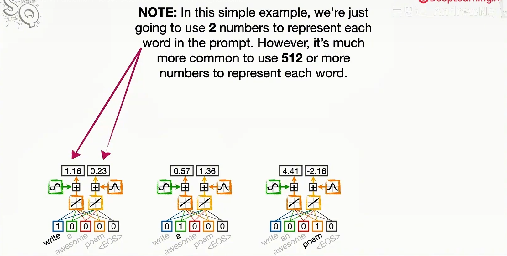 
After we get the encoding, we multiply the encoding matrix by the Q,K,V weight matrices respectively  and we can get the Q,K,V. A concret example is show in the figure below.
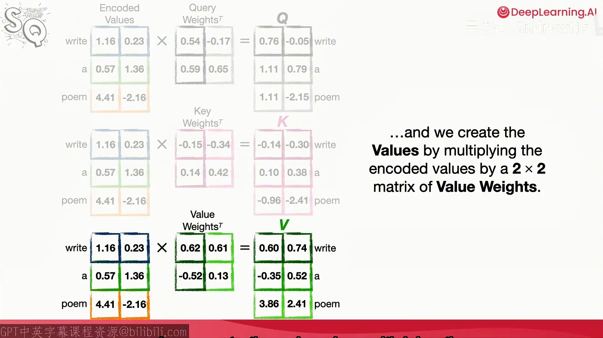
Note: Query weight matrix, Key weight matrix, Value weight matrix are all labeled with transpose symbol. this is because Pytorch prints out the weights in a way that require them to be transposed before we can get the math to work out correctly.

And now we come to see the culculation of self-attention:
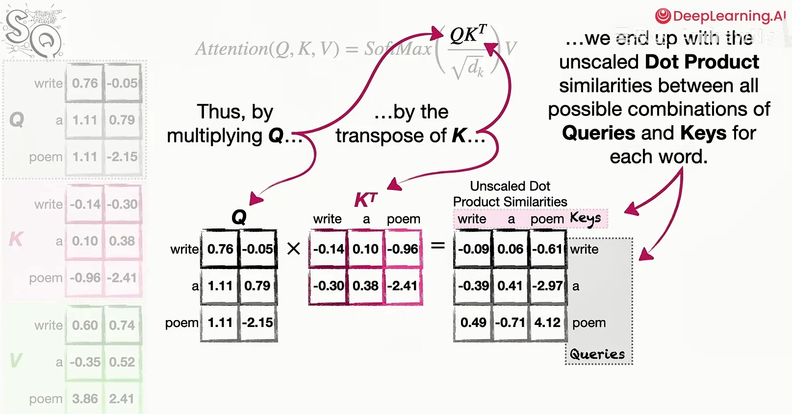
Question: Why  does the K need to be transposed?
Answer: Because we need to use dot product to measure the similarity between each encoding, and the transpose is an indispensable step.
Note: the origial authors of transformer said the scaling factor $\sqrt{d_k}$ can improve performance significantly

After we get the unscaled dot product similarity matrix, we next take the softmax of each row in the matrix. And then we multiply the scaled dot product similarity matrix by V, so that we can get the self-attention score matrix.
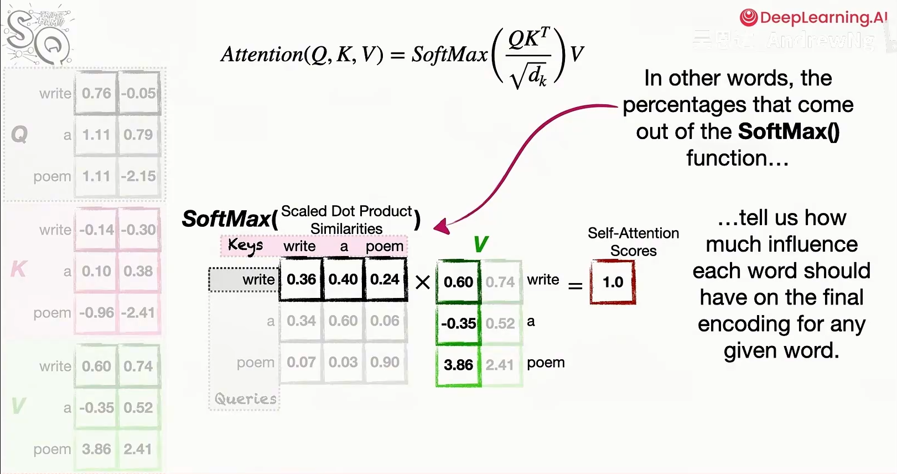

# 4. Coding Self-Attention in pytorch
``` python
class SelfAttention(nn.Module):
    def __init__(self, d_model=2, row_dim=0, col_dim=1): #对于类的普通实例方法，必须有第一个形参来接收实例本身，这里是self
        super().__init__()
        self.W_q = nn.Linear(in_features = d_model,      #全连接线性变换层，数学本质为: Y=Wx+b
                             out_features = d_model,
                             bias = False)
        self.W_k = nn.Linear(in_features = d_model,
                             out_features = d_model,
                             bias = False)
        self.W_v = nn.Linear(in_features = d_model,
                             out_features = d_model,
                             bias = False) 
        self.row_dim = row_dim
        self.col_dim = col_dim

    def forward(self, token_encodings):
        q = self.W_q(token_encodings)
        k = self.W_k(token_encodings)
        v = self.W_v(token_encodings)

        sims = torch.matmul(q,k.transpose(dim0=self.row_dim, dim1=self.col_dim)) 
        #将 $K$ 的第 0 维（行）与第 1 维（列）互换，等价于矩阵转置 $K^T$。形状从 $(N, d)$ 变为 $(d, N)$。 
        #transpose()方法接收两个关键字参数dim0, dim1
        scaled_sims = sims/torch.tensor(k.size(self.col_dim)**0.5) 
        #k.size(dim) 去k张量的dim维度的大小
        attention_percents = F.softmax(scaled_sims, dim = self.col_dim)
        attention_scores = torch.matmul(attention_percents, V)

        return attention_scores

```
E.G.:
```python
encoding_matrix = torch.tensor([[1.16, 0.23],
                                [0.57, 1.36],
                                [4.41, -2.16]])
torch.manmul_seed(42)  #manual: 手动的
selfAttention= SelfAttention(d_model=2, row_dim=0, col_dim=1)
selfAttention(encoding_matrix)

tensor([1.0100, 1.0641
        0.2040, 0.7057
        3.4989, 2.2427], grad_fn = <Mmbackward0>)  
        #grad_fn是gradient function的缩写。
        #Mm是 matrix multipication的缩写
        #0是pyTorch 内部代码生成工具（Code Generator, 如 gen_autograd.py）自动生成的重载编号或实例标识。
```

# 5. Self-Attention And Masked Self-Attention
Self-Attention is just one type of Attention, and the type we use can have a profound effect on what we can do with it. In order to understand these profound differences, let's start by diving in things we can do with Self-Attention.

We first talk more about how transformer convert the word into numbers with Word Embedding. One simple way is to just assign each word to a rnadom number. 
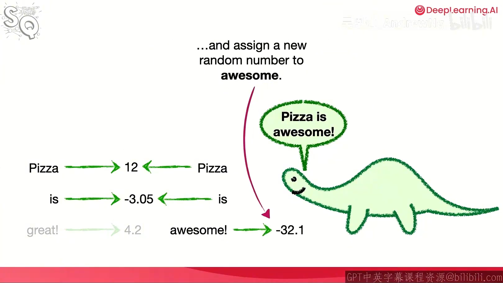
Take the example showed in above picture into consideration. If we assign great! to the number 4.2 and assign awesome! to the number -32.1, it means that although great! and awesome! means similar and are uesd in  similiar ways, they have different numbers represent they, and that means the neural network will probably need more complexity because learning how to correctly process the word great! won't help the neuro network correctly use the word awesome! So it would be nice if we can assign similar words used in similar ways to similar numbers. And because the same words can be used in different context, or made piural, or used in some other ways, it might be nice to assign easch word more than one number, so that the neural network can more easily adjust to different contexts.
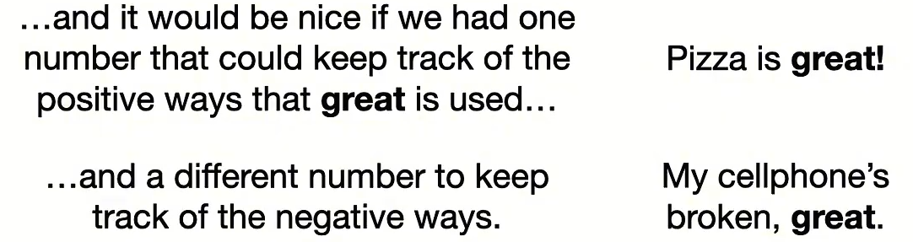 
Although convert each word to number is a complex task, years before Transformers were invented, people created stand alone neural networks to create Word Embeddings for us.

Let's create the Word Embeddings for these to phrases:
1. Pizza is great!    
2. Pizza is awesome!
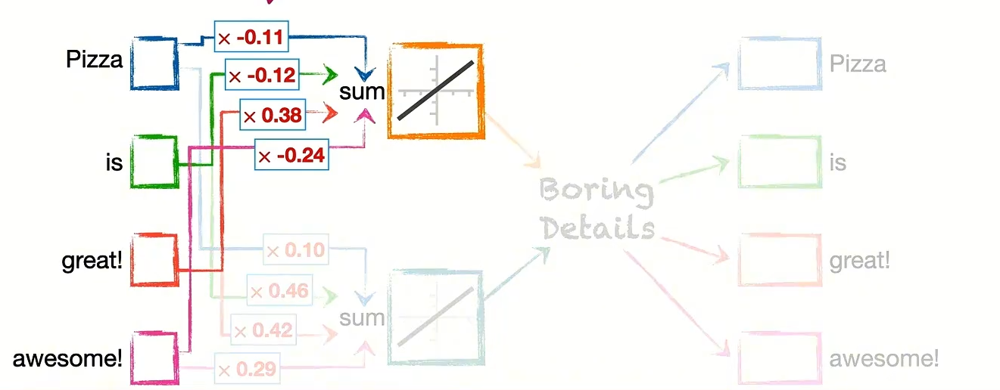
First, we create inputs to a relatively simple neural network for each unique word, and then we create output for each word. Then we connect all the inpputs to at least one activition function.In this example, we choose two activition function. The number of the activition function determines how many numbers are used to represent each word. Then we add weights, numbers we multiply the imputs by, to the connections from the inputs to the activiton functions. These weights which are the Word Embeddings values, are initialized with random numbers. So,they are not very useful now. The plan is to train with the data. Lastly, we connect the activition function to the output layer with some boring detail that we needn't to worry now. Becasue we use a vector with two dimensions to represent each word, we could plot each word embeding on a 2-dimensions graph.
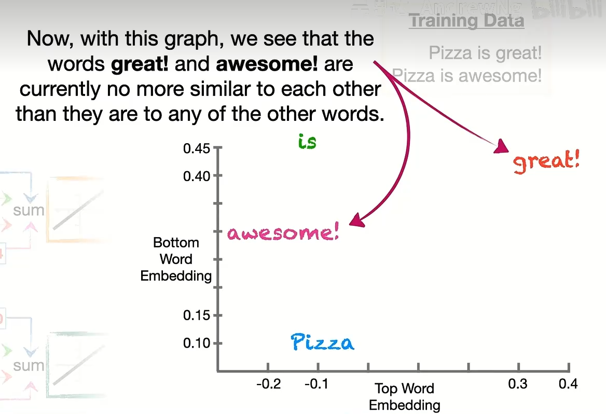
Because the word "great" and "awesome" appear in the similar contexts and they have similar meanings in the trainng data, we hope that training the network will make their Word Embeddings more similar.

The idea is that we want each word in the training data predict the next word in the sentence. So in order to see which word the neural network will predict after the word "Pizza", we put a 1 in input for pizza, and put zeros in any other inputs. And  then if we do the math with the randomly initialized parameters, we might end up predicting the word "great", because the output value  correspond to the word great is the largest. Thus with the randomly initialized parameters, the neural network can not correctly predict the word come after the word "Pizza", "is".
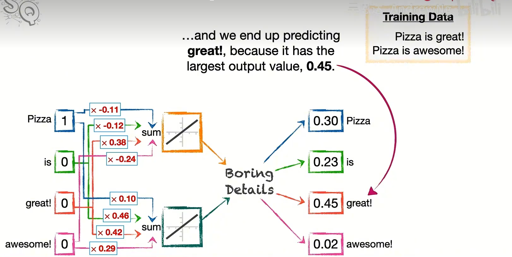
But after training the neural network, we can make correct predictions and the Word Embeddings of "great!" and "awesome!" would become more similar.

However, just predicting the next word doesn't give us a lot of context to determine the optimal Word Embeddings. In contrast, if we have more complicated training dataset, our neural network will have more inputs and outputs. But now we have more longer sentences in the training data, we can add more contexts to the training process. For example, we can use the "The pizza came out" to predict the word come after the word "out". To realize this ,we nedd to put "1" in the inputs correspond to the word "The"、"pizza"、"came"、"out" . However, the way we are doing right now ignore the word orders. And because we not currently keeping track of word order, any jumble is just as good as anything else. In other words, "The pizza came out of the " would give the same inputs and outputs as the jumbled up phrase "Pizza out came the of". But as we all know, word order is important. So it would be nice if we can take take word order into account when we create Word Embedding values. The good news is that is exactly what the Positional Encoding layer in a Transformer does. 
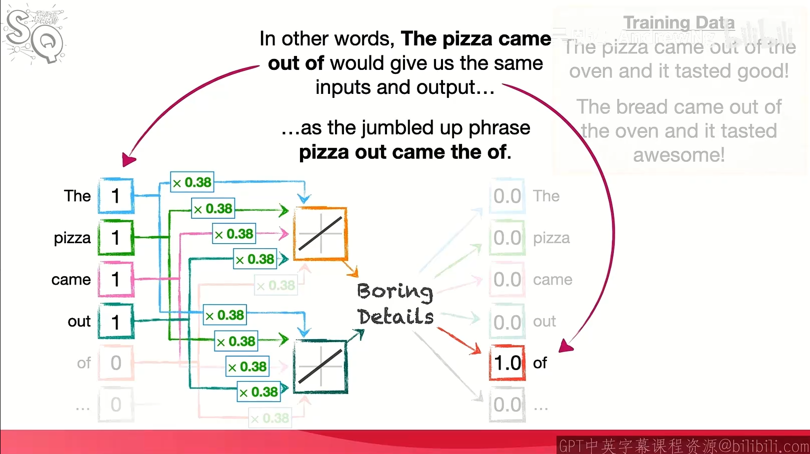

And when we use Self-Attention, which factors in all of the words, including those that came after the word of interest, then we create a new kind of embedding that sometimes called "Context Aware Embedding" or "Contextualized Embedding". Compared to Word Embeddings which only clusters individual words, Context Aware Embedding can help cluster similar sentences, adn they can even cluster similar documents.

Transformers that only use Self-Attention are called Encode-only Transformers, and the Context Aware Embedding that they create are super useful. In addition to clusting sentences and documents, Context Aware Embddings can be also used as inputs to a normal neural network that clssifies the sentiments of the inputs.
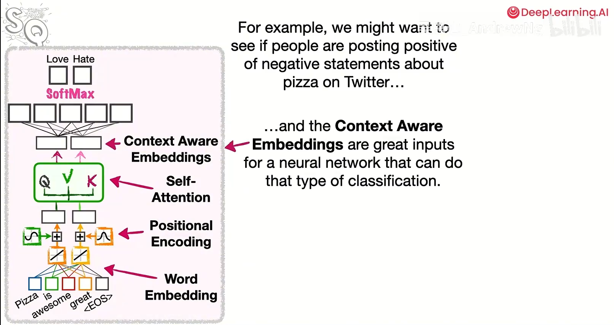
Next we will talk about another type of Transformer calle a Decoder-Only Transformer.
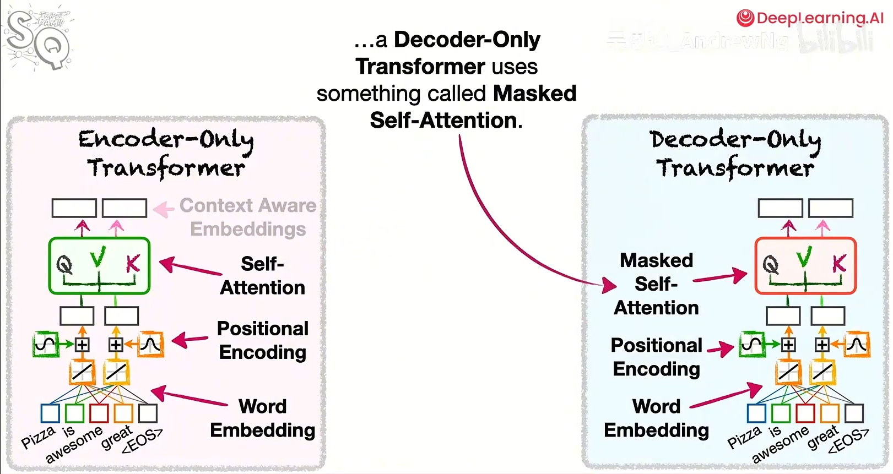 
And a big difference between Self-Attention and Masked Self-Attention is, Self-Attention can look at the words before and after the word of interest, in contrast, Masked Self-Attention ignore the words come after the word of interest.
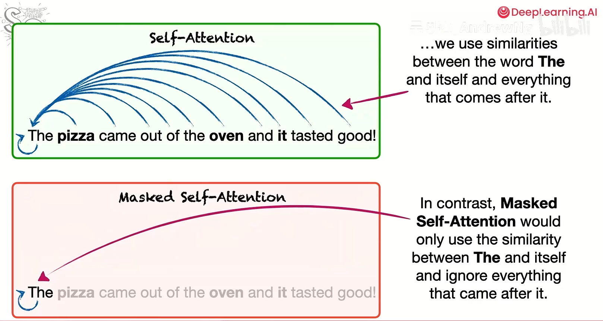 
Because Decoder-Only Transformers use Masked Self-Attention, and can never look ahead at what comes next, they can be trained to do a really good job generating response to prompts. That,s why ChatGPT,which is a Decoder-Only Transformer, is called a Generative Model. A Decoder-Only Transformer creates Generative Inputs that can be plugged into a simple Neural Network that generates new tokens.
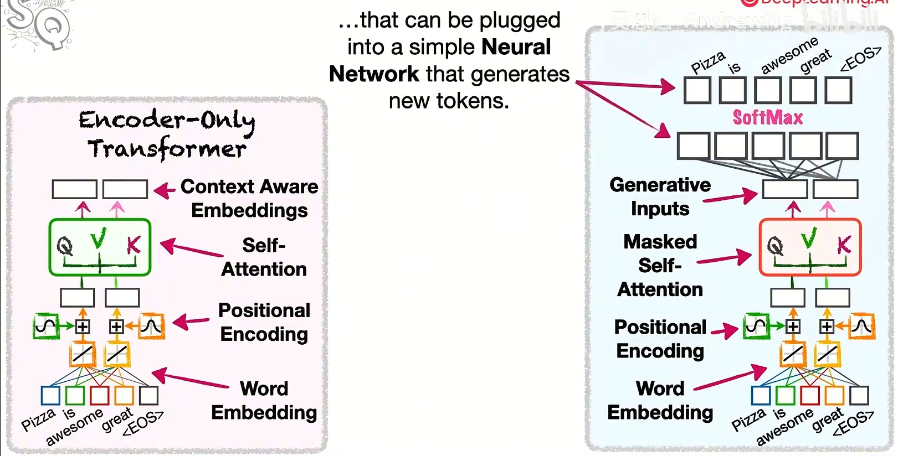 

# 6.The Matrix Math For Culculating Masked Self-Attention
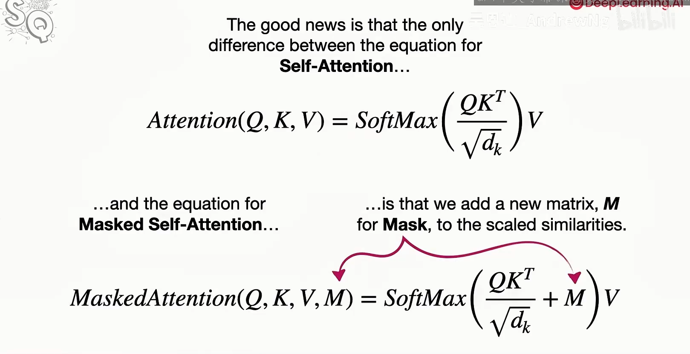
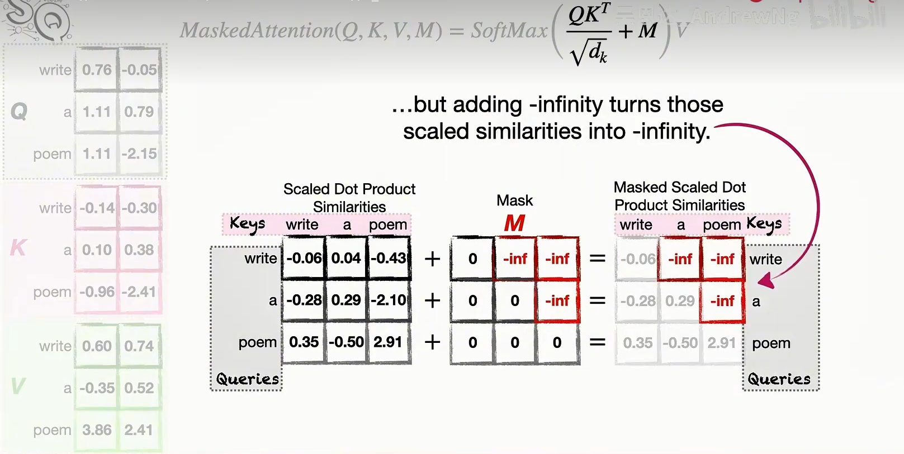
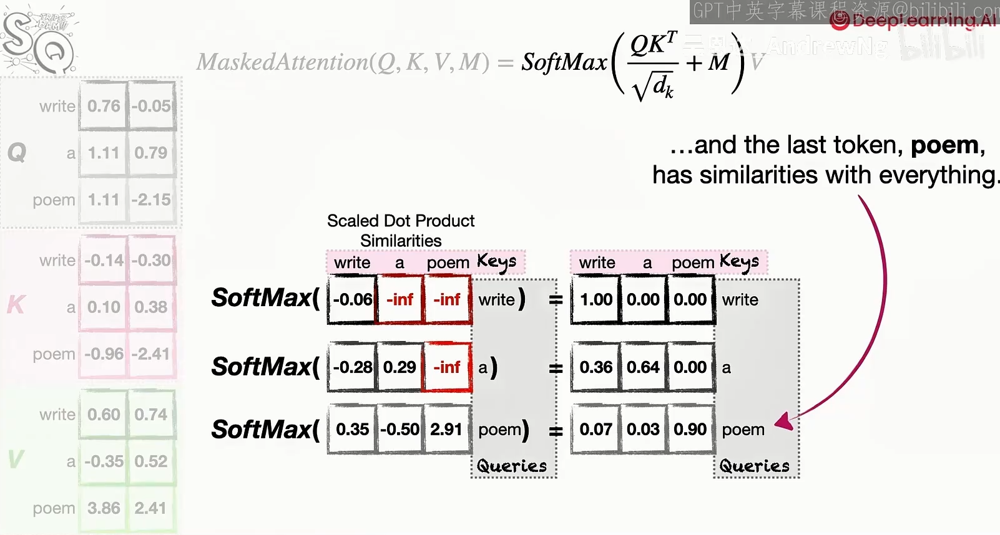
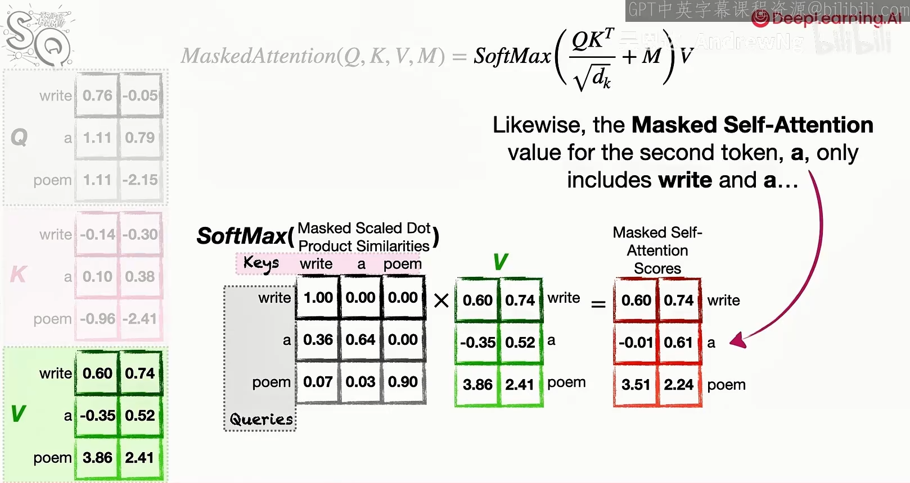

# 7.Coding Masked Self-Attention in PyTorch
```python
import torch 
import torch.nn as nn
import torch.nn.functional as F

class Masked_SelfAttention(MOdule):
    def __init__(self, d_model=2, row_dim=0, col_dim=1):
         #row_dim:每一行代表一个token，所以是序列维
         #col_dim:每一列代表一个特征维度，所以是特征维
        super().__init__()
        self.W_q = nn.Linear(in_features = d_model, out_features = d_model, bias = False)
        self.W_k = nn.Linear(in_features = d_model, out_features = d_model, bias = False)
        self.W_v = nn.Linear(in_features = d_model, out_features = d_model, bias = False)

        self.row_dim = row_dim
        self.col_dim = col_dim

    def forward(self, token_encodings, mask=None):
        q =  self.W_q(token_encodings)
        k =  self.W_k(token_encodings)
        v =  self.W_v(token_encodings)

        sims = torch.matmul(q, k.transpose(dim0=self.row_dim, dim1=self.col_dim))
        scaled_sims = sims/torch.tensor(k.size(self.col_dim)**0.5)
        if mask is not None:
            scaled_sims = scaled_sims.masked_fill(mask=mask, value=-1e9)
        
        Attention_percent = F.softmax(scaled_sims, dim=self.col_dim)  
        #沿着序列维做softmax，使得每一列元素之和为1。
        Attention_scores = torch.matmul(Attention_percent, V)

        return Attention_scores
```
# 8. Encoder-Decoder Attention
Before Encoder-Only and Decoder-Only transformer exited, the first Transformer ever made had one part called Encoder that used Self-Attention and one part called Decoder that used Masked Self-Attention. And the Encoder and the Decoder were connected to each other so they could calculate something  called Encoder-Decoder Attention. Encoder-Decoder Attention uses the output from the Encoder to calculate the Keys and Values and the Queries are calculated from the output of the Masked Self-Attention generated by the Decoder. The first Transformer was based on something called a Seq2Seq, or an Encoder-Decoder model. Seq2Seq models were designed to translate text in one language into another language. It wasn't long after this first Encoder-Decoder Transformer was invented that people realized that they could build a model that did intersting things with just the Encoder and those model only used Encoder were called Encoder-Only transformers. Likewise, it wasn't long before people realized that they could generate text, including translation of text with just a Decoder, And those model were called Decoder-Only Transformers.

So far we have learned a 3rd type of attention, Encoder-Decoder Attention, which is also called Cross-Attention. Encoder-Decoder Attention simply requires us to be flexible with respect to how we calculate the Query, Key, and Value matrices.

# 9. Multi-Head Attention
So far we have seen that Attention helps establish how each word in the inputs is related to the others. And for a simple example, what we have seen so far works fine. However, in order to establish how words are related in longer, more complicated sentences or paragraphs, we can apply Attention to the Encoded values multiple times simultaneously. Each attention unit is called a Head and has it own sets of Weights for calculating Querys, Keys, Values. And when we have multiple Heads calculating Attention, we call it Multi-Heads Attention.

In our example, with 3 Heads, and 2 Attention values per Head, we end up with 6 Attention values. In order to get back down to original number of Encoder Values that we start with (2), we simply connect all the Attention values to a fully connected layer with 2 output units.
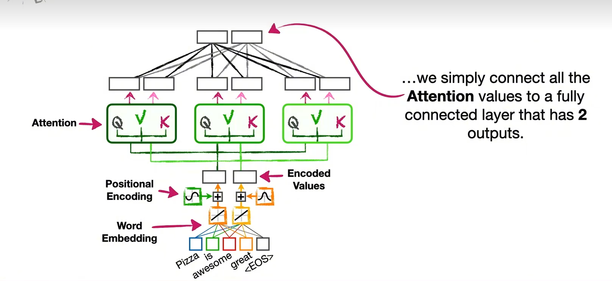.

Note: Another commonly used way to reduce the number of outputs is to modify the shape of Value Weight matrix. So far, we used the Value Weight matrx with 2 columns,  and that gives a Value matrix with 2 columns and as a result, each Attention Head has 2 outputs. However, if we use weight mnatrix with only 1 column, each Attention Head will have 1 output. And in order to obtain 2 Encoded values, we can use 2 Heads to get back to the same number.
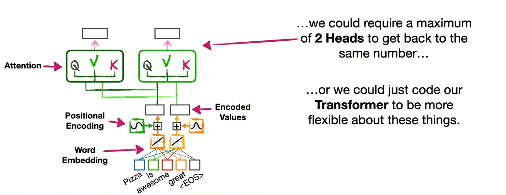

# 10 Coding Encoder-Decoder Attention and Multi-Head Attention in Pytorch.
```python
import torch
import torch.nn as nn
import torch.nn.functional as F

class Attention(nn.module):

    def __init__(self, d_model=2, row_dim=0, col_dim=1): 
        #约定“行”用dim 0表示(t.size=行数)，"列"用dim 1表示（t.size=列数）。
        super().__init__()

        self.W_q=nn.Linear(in_features=d_models, out_features= d_model, bias=False)
        self.W_k=nn.Linear(in_features=d_models, out_features= d_model, bias=False)
        self.W_v=nn.Linear(in_features=d_models, out_features= d_model, bias=False)
        
        self.row_dim = row_dim
        self.col_dim = col_dim

    def forward(self, token_encodings, encoding_for_q,
                                       encoding_for_k,
                                       encoding_for_v,
                                       mask=None):
        q = self.W_q(encodings_for_q)
        k = self.W_k(encodings_for_k)
        v = self.W_v(encodings_for_v)

        sims = torch.matmul(q, k.transpose(dim1=self.row_dim, dim2=self.col_dim))
        scaled_sims = sims/torch.tensor(k.size(self.col_dim)**0.5)
        # 除以K的特征维度而不是序列维度的0.5次方的原因：sims的每个矩阵元的计算过程中涉及了序列维度的相乘与求和 
        if mask in not None:
            scaled_sims = scale_sims.masked_fill(mask=mask, value=-1e9)
        
        attention_percents = F.softmax(sacled_sims, dims=self.col_dim)
        attention_scores = torch.matmul(attention_percents, v)

        return attention_scores
```
e.g.:
```python
encodings_for_q = torch.tensors([[1.16,0,23],
                                 [0.57,1.36],
                                 4.41,-1.26])
encodings_for_k = torch.tensors([[1.16,0,23],
                                 [0.57,1.36],
                                 4.41,-1.26])
encodings_for_v = torch.tensors([[1.16,0,23],
                                 [0.57,1.36],
                                 4.41,-1.26])
#这里之所以把三个encoding设置成一下单纯是为了验证后续计算结果正确与否
torch.manual_seed(42)

attention = Attention(d_model=2,row_dim=1,col_dim=1)
attention(encodings_for_q,
          encodings_for_k,
          encodings_for_v)
```
Next let's talk about Multi-Heads Attention:
```python
class MultiHeadAttention(nn.module):
    def __init__(d_model=2, row_dim=0, col_dim=1, num_heads=1):
        super().__init__()
    self.heads = nn.ModuleList([Attention(d_model,row_dim,col_dim) for _ in range(num_heads)])
    # 每个注意力对象使用相同的模型维度、行维度与列维度进行初始化

    self.col_dim = col_dim

    def forward(self,
                encodings_for_q,
                encodings_for_k,
                encodings_for_v):
        return torch.cat([head(encodings_for_q,
                               encodings_for_k,
                               encodings_for_v)
                               for head in self.heads], dim = self.col_dim)

``` 
# 11.Conculsion
略