# 12 How Transformer LLMs Work?
So far we have learnt a lot about Encoder Model and Decoder Model and we can summarize them in the below picture:
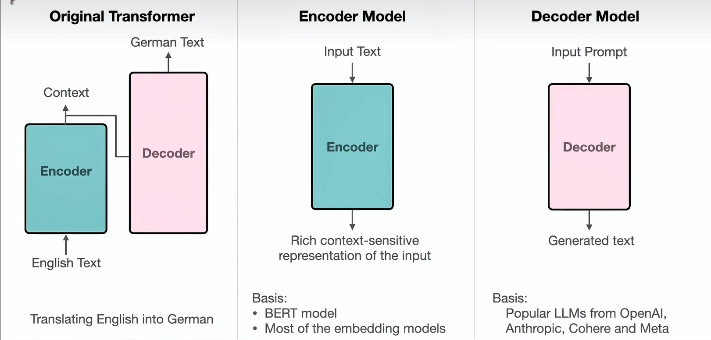
Next what we will study is summarized as the outline below:
1. Delve into recent developments in LLMs.
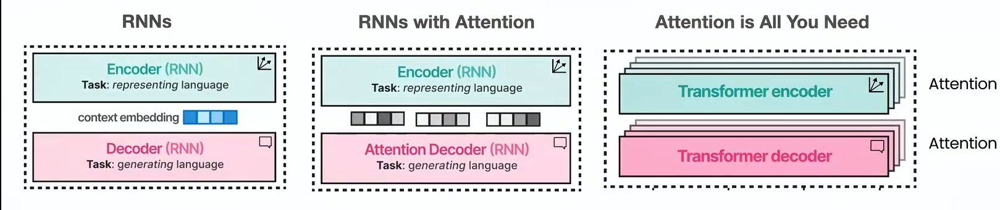
2. Learn about tokenization.
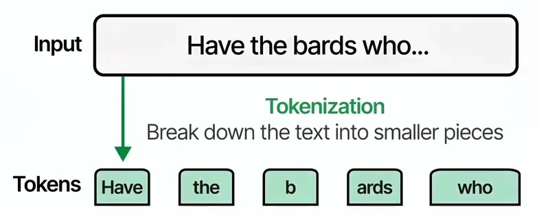
3. Gain intuition about how transformers work.
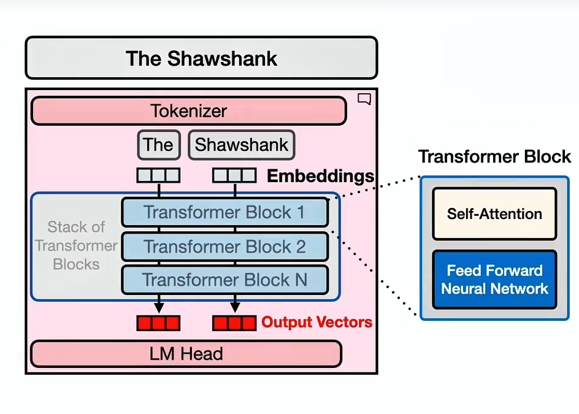

Note: The magic of LLMs actually come from two parts:One, the Transformer architecture, which you learn is well worth learning. And second, all the incredibly rich data that the models learn from.

# 13. Bag of words
In the next several lessons, we will learn the evolution of how language has been represented numerically.

We'll start with Bag-of-Words, an algorithm that represents words as large sparse vectors, or arrays of numbers, which simply record the presence of a word. Then the Word2Vec, whose word representations capture the meaning of the words in the context of a few neighboring words. Finally, transformers, whose vectors capture the meaning of words in the context of a sentence or a paragraph.
Let's review a recent history of language AI first.
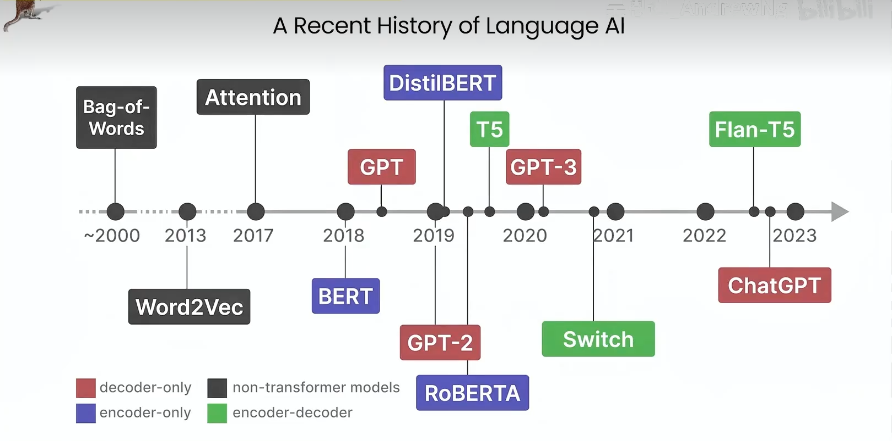

Language is a tricky concept for computers. Text is unstructured in nature and loses its meaning when represented by zeros and ones or individual characters.
As a result, througout the history of language AI, there has been a large focus on representing language in a structure manner, so that it can more easily be used by computers. From generating text, to create numerical representations and classify textual input, these are just a few of the numerous tasks you can do with Language AI. At the start of the language AI field, the focus was mainly on representing language to analyze unstructure datas. 
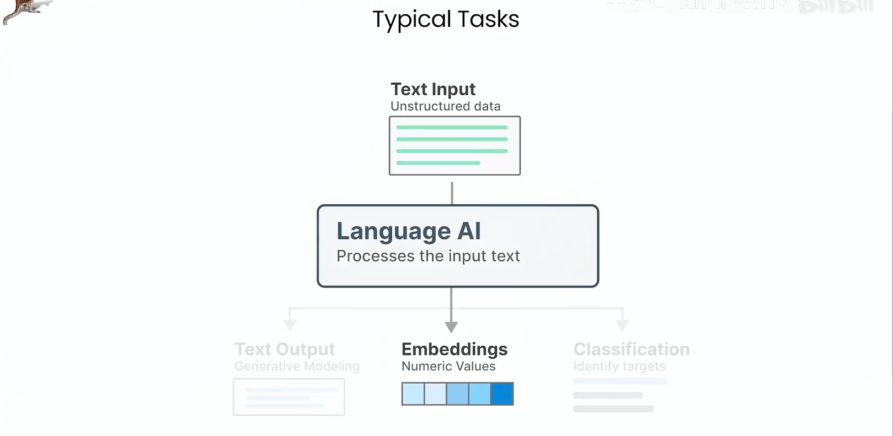


A first and still very relevant method is by representation language as a bag of words model:
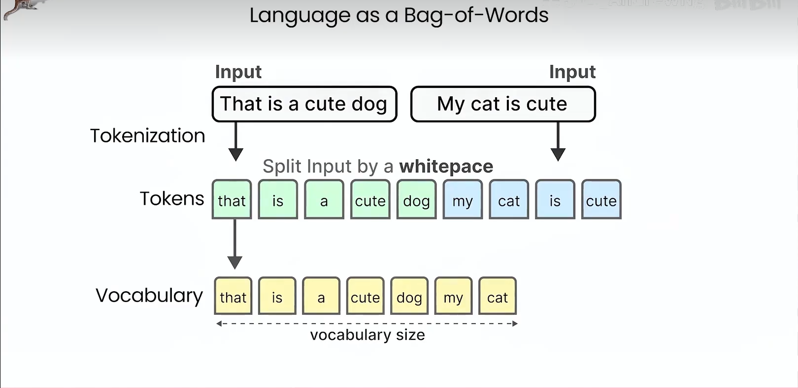
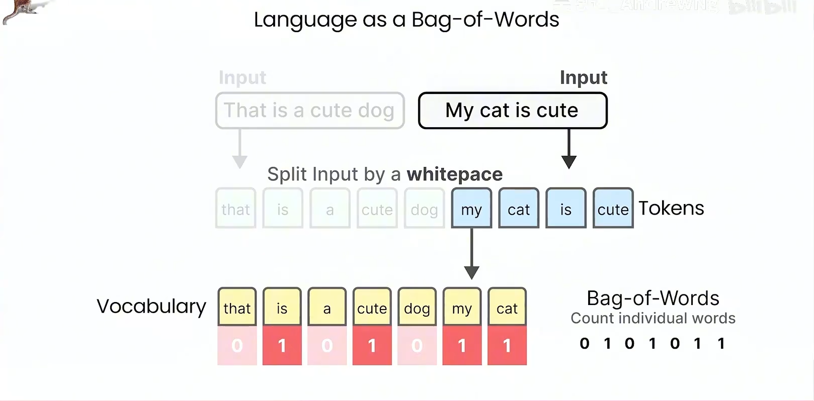
* Note: A token can be smaller than a word; Word order is not important in this model.

In practice, we called "0 1 0 1 0 1 1" a Bag-of-Words representation. In this example, using the Bag-of-Words model, these values are counts,  and have an explicit meaning, namely the number of times of a word in vocabulary appears in the input. Vector representations in more complex and advanced model typically don't have such an intuitive meaning and usually have values between 0 and 1.

# 14. Word Embeddings
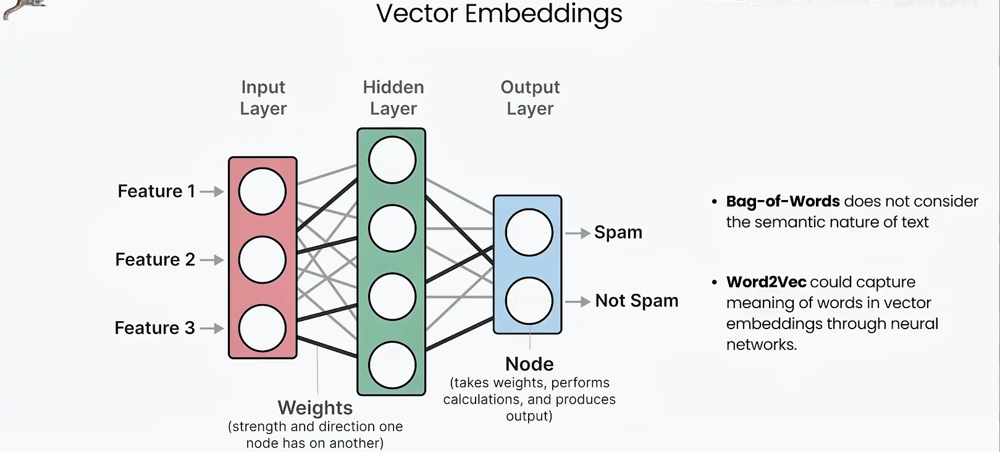
Word2Vec learns semantics representations of words by training on vast amount of textual data like the entirety of Wikipedia. To generate these semantic representations, Word2Vec leverages neural networks. Using these neural networks, Word2Vec generated word embeddings by looking at which other words they tend to appear next to in a given sentence. You start by assigning every word in your vocabulary a random initialized vector embedding. Then in every update step, you take pairs of words from the training data and the model attempt to  predict whether or not they are like to be neighbors in a sentence. During these process, Word2Vec learns the relationship between words and distills that information into the embedding. If two words tend to have the same neighbor, their embeddings generated by Word2Vec tend to be closer.
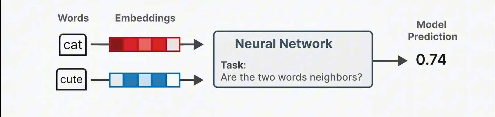

Let's illustrate it through a concrete example. Imageing we have an mbedding for word "cats". Embeddings attempt to capture meaning by representing the properties of words. For example, the word "cats" might score low on the property newborn and human and fruit but score high on the property animal and plural. Note that the number of dimensions can be quite large, where it is common to see embeddings with more than a thousand dimensions. 
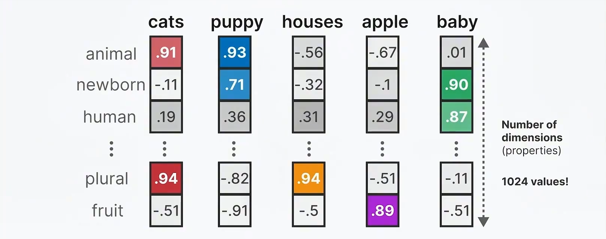

However,in practice, we uaually don't know what these properties exactly represent, as they are learnt through complex mathematically calculations.

When we talk about a model  like Word2Vec that convert the textual input into embeddings, we refer it as a representation model. Imaging that you have some input. For example, the sentence, "Her vocaliztion was melodic". Through tokenization, you can split the whole sentence into several tokens. Note that this process in not splitting the input just by whitespace. The reason for this is that models that perform tokenization, also called tokenizer, has a fixed vocabulary. As a result, they can not represent all words that exist, but sometimes have to find combinations of exist words. If you put these tokens as inputs of Representation Model,  the Representaion Model will output the embeddings, one embedding for each token. When you average the embeddings of these tokens, you get a word embedding as now it represents the entire word. Similar tecniques can be used for a whole sentence or a document and you can get a sentence embedding or a document embeddding. 
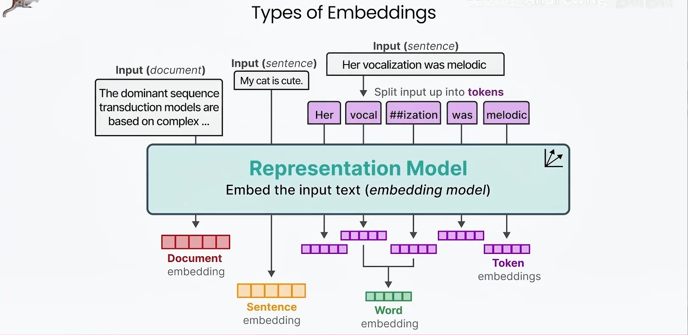

# 15. Encoding and Decoding Context with Attention
 
Word2Vec creates statics embeddings: For example, the same embedding is generated for the word "bank" regardless of the context. Bank can refer to both a financial bank, as well as the bank of a river. So its meaning, and there refers to its embedding, should change depending on the context. Capturing the text's context is important to perform some text tasks, such as translation. A step in encoding this text was achieved through Recurrent Neural Networks, or RNNs. These RNNs are used for 2 tasks: encoding(representing an input sentence) and decoding(generating an output sentence). Let's explain this by showcasting how the sentence"I love llamas" get translated to Dutch. First,the sentence is passed to the encoder, which attempts to represent the whole sentence into embeddings.The decoder than uses these embeddings to generate language. Here, it translated the English"I love llamas" into the dutch "Ik hou van lama's"
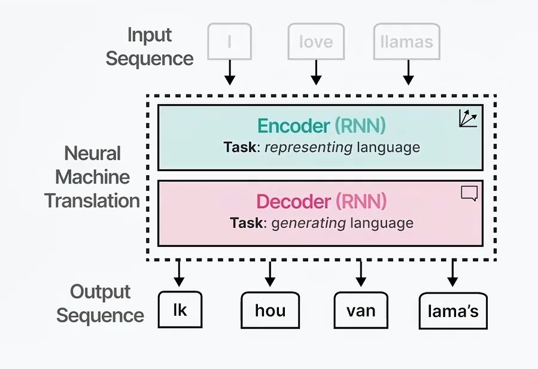  
Each step in this architecture is autoregressive. When generating the next word, this architecture needs to consume all previously generated words. For instance, you take the input "I love llamas". The model than generates the fisrt token, which is "ik", To then generate the next token, the output is appended to the input. In step2, the input is now "I love llamas ik", and then the model will generate the next token "hou". You can continue this process at each step, till the entire output is generated. 
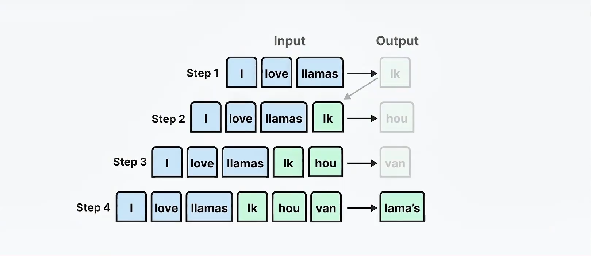

Now we talk about this encoding and decoding in more details. First, we can use the Word2Vec to create the embeddings of the input. Although these embeddings are static by themselves, the encoder processes the entire sequence in one go and takes into account the context of the embeddings. The encoder aims to represent the inputs as well as possible and generate the embeddings which include the imformation of context. The decoder in turn is in charge of generating language, and does so by leveraging the previous generated embeddings. As we explored previously, the output tokens are generated one at a time, which is called autoregressive generation.
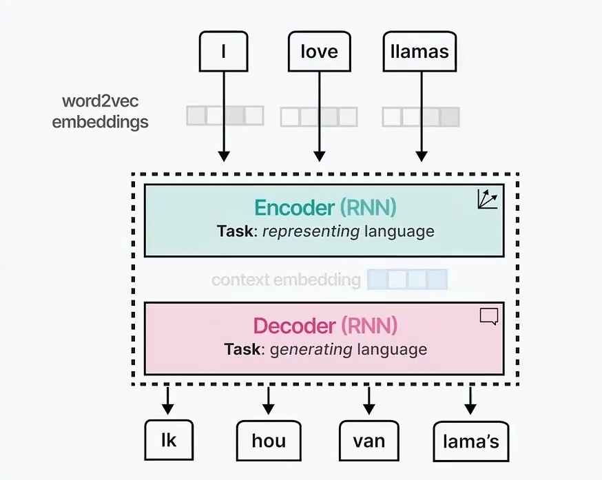 
However,this kind of embedding makes is difficult to deal with longer sentence. Since it use merely a single embeddings to represent the whole sentence. So the single embedding might fail to capture the entire context of a long and complex sequence. In 2014, a solution called attention was introduced and highly improved the original architecture. Attention allows a model pay more attention to parts of input sequence that are relevant to each other. Attention selectively determines which words are more important in a given sentence.
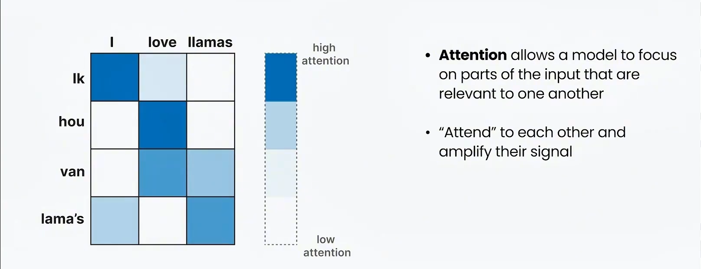
By adding these attention mechanisms to the decoder step, the transformer can generate signals for each input in the sequence related to the potential outputs. You can again represent the input using the Word2Vec embeddings and pass them to the encoder. Instead of passing only a context embedding to the decoder, the hidden states of all input words are passed to the decoder. A state for a word is an internal factor from a hidden layer of an RNN that contains the information of previous words. The decoder than use the attention mechanism to look at the whole sequence. Finally, it generates the language again. Due to the attention mecahnism, the model's performance improves a lot.  Since now you look at the entire sentence using embeddings for each token instead of the smaller and more limited context window. But the sequence nature of this architecture precludes paraleliztion during the training of the model.
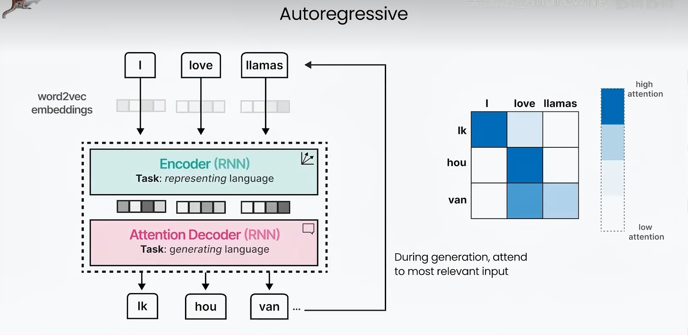

# 16. Transformers
Transformer is a new architecture solely based on attention and without the RNN. It could be trained in parallel which speeds up calculation significantly.

Now let's explore how this transformer works. Transformer mainly includes 2 parts: Transformer encoder and Transformer decoder.
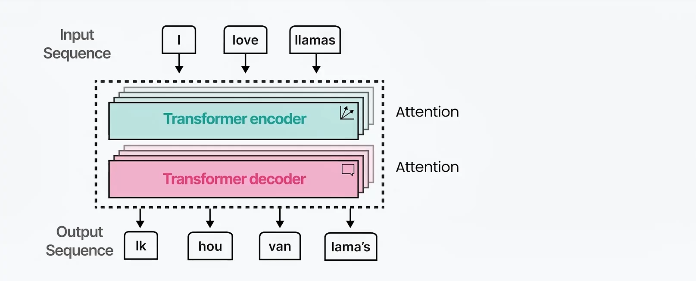
Transformer encoder: First, the input "i love llamas" is converted to embeddings. But unlike Word2Vec embeddings, we start with random values. Then self-attention, which is attention focused on only the input, processes these embeddings and update them. These updated embeddings contains more contextualized information as a result of attention mechnism. Then they are passed to a feed-forward neural network， which is a similar network as we explored before to finally create the contextualized token or word embeddings. Remember that the encoder is meant for(be meant for...,为...设计、打算) representing text and does a good job of generating embeddings. Self-Attention is an attention mechanism, and instead of process two separate sequences, it process only one sequence， the input, by comparing it to itself. After the encoder complete it's job，the next step is for the decoder. The decoder can take any previously generated words and pass it to the masked self-attention to process these embeddings. Then the intermediate embeddings are generated and passed to another attention network，together with the encoder's embedding.And this output is passed to the language model head and finally generate the next word in the sequence. 

Note:  Masked self-attention can prevent laeking information when generating the output.
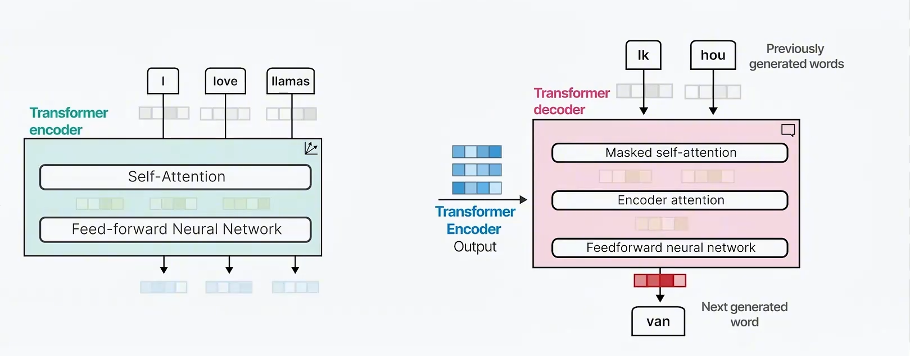

The original trandformer is an Encoder-Decoder architecture that severs translation task well, but can not easily be used for other tasks.

In 2018, a new architecture called Bidirectional Encoder Representtaion from Transformers(BERT) was introduced that could be leveraged for a wide variety of tasks. BERT is an encoder-only architecture that focus on representing language and generating contextualizd word embeddings
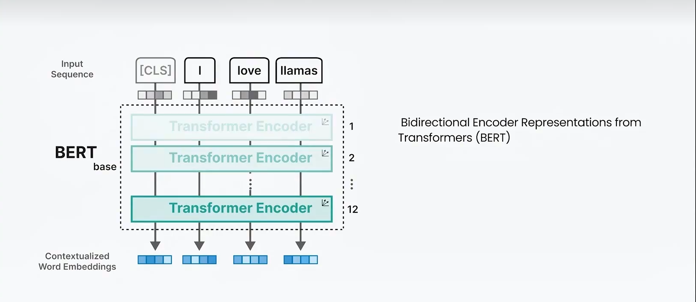
These encoder blocks are the same as we saw before, self-attenton followed by feed-forward layers. The input contains an addtional token, the CLS token or classification token, which is used as a representaion for the entire input. Often, we use the CLS token for fine-tuning the model on specific tasks, like classfication. To train a BERT model, we use a tecnique called masked language modeling. You first randomly mask some words in the input sequence， and then let the model predict these masked words. By doing so, the model learn to represent language to predict masked words. Training BERT mainly contains 2 stages. In the first stage, we apply masked language modeling on large amounts of datas, which is called pre-train. In the second stage, 为fine-tune our pre-trained model to make it get used to a lot of downstream tasks.
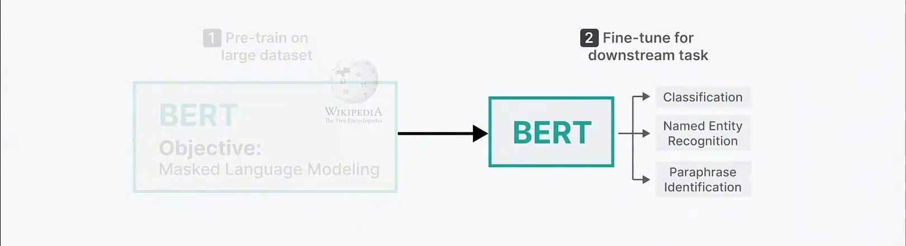  

BERT is a representation model, and another commonly seen model is generative model. These models have something in coomon, called the coontext length.
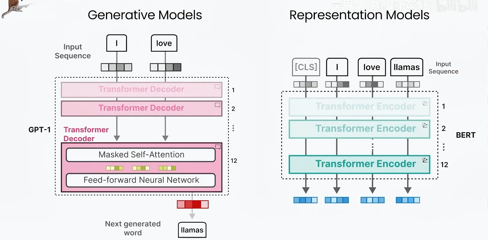

The illustration of context length of a generative model:
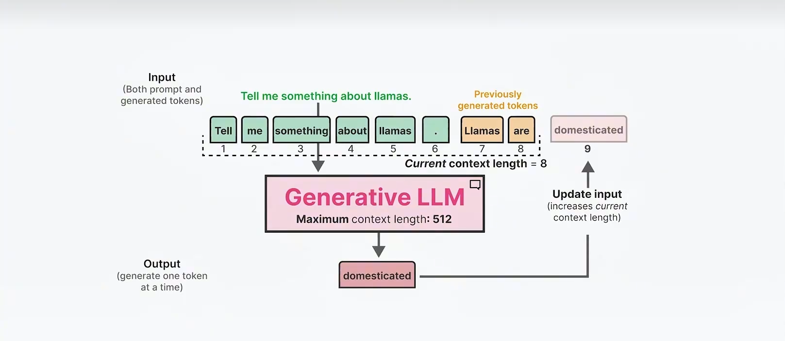

The paremeters of generative models:
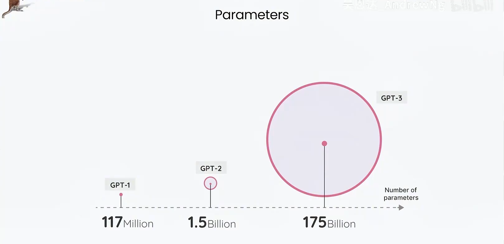

# 17. Tokenizers

In the last lesson, we have learnt how to represent words's meaning with vectors. We briefly introduced tokens as words or words pieces. In this lesson, we will illustrate what those are and how they help transformers do their work.

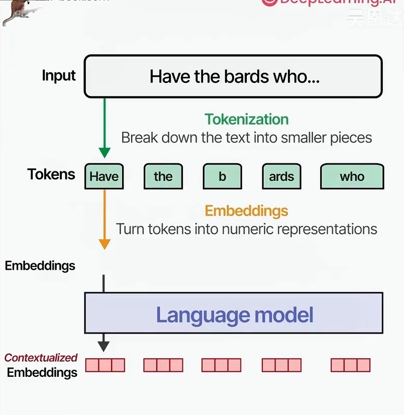
Image we have the input "Have the bards who". For a language model to process that input text, it will first split the sentence into small pieces and each piece is called a token. Then each token is converted into a numeric representation, also called embeddings. These are embeddings that represent the semantic nature of given text and these embeddings are static and each embedding is created independent from all other embeddings. And then these embeddings are processed by Language and converted into contextualizd embeddings. These embedding tokens are still one for each token,but have been processed such that they will contain other embeddings' information. These embeddings can be the output of a model but alse used by the model to then
create the output. In the case of generative models, this can be another token.
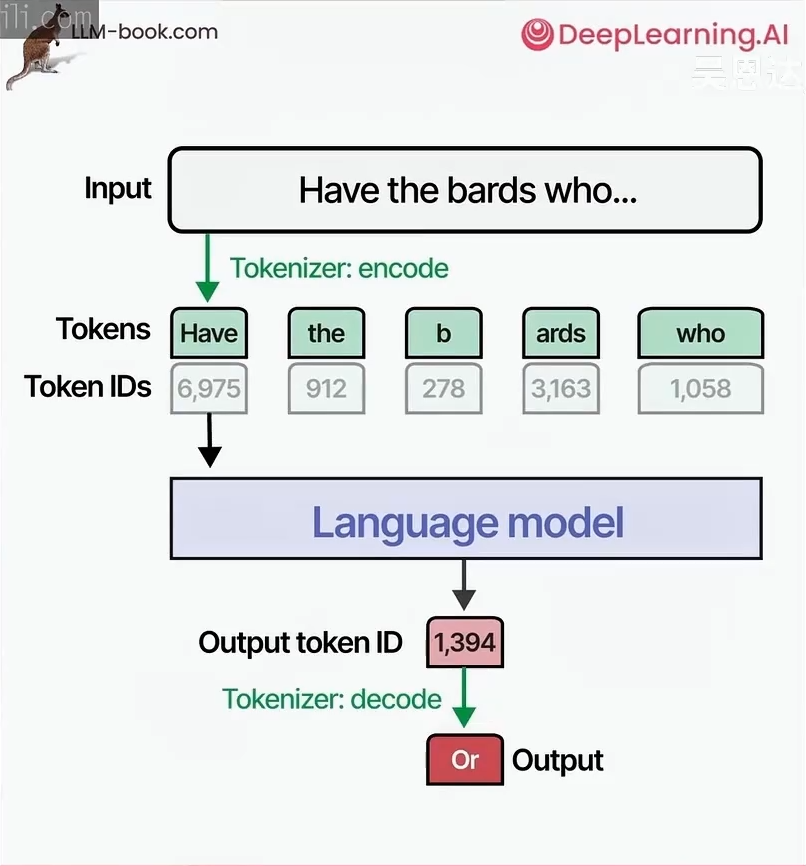  
Why sometimes a token is a word pieces instead of an entire word:  
Because tokenizer has a limited number of tokens or vocabulary. So whenever it encounters an unknown word, it can still represent it by these tokens corresponding to sub words. Each token has an associated fixed ID to easily encode and decode the tokens. 

There are many different tokenization that we can explore. Assume that you have an input, like the BERT model, which is pre-trained, together with a special symbol:

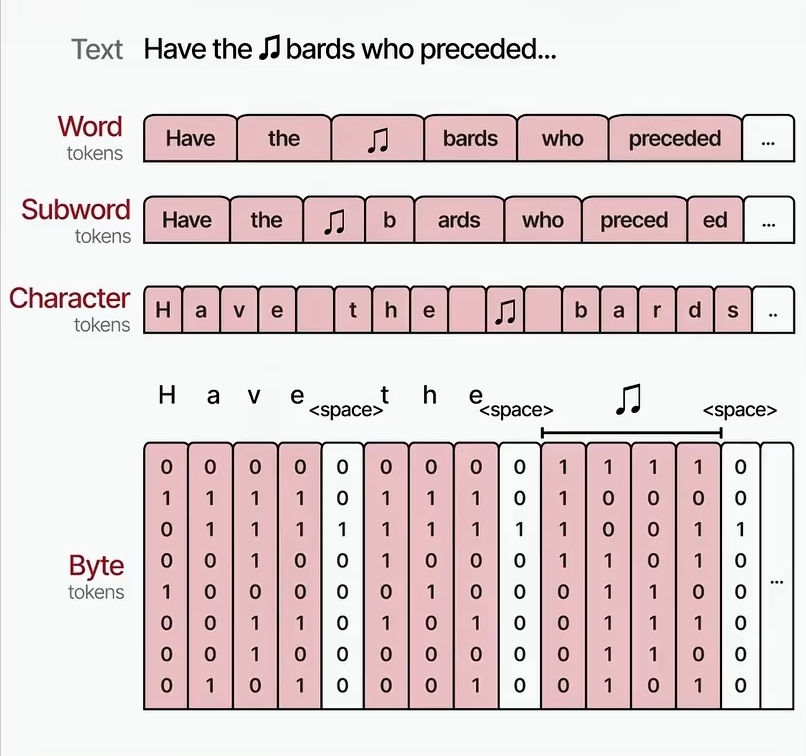  
In practice, most language models have tokenizers that works on a subword tokens level. Its vocabulary has flexible and allows to represent most words by its entire representation or use subwords.

Let's now explore different tokenizers:
```python
# Set up
pip install transformers

# Tokenizing Text
from transformers import AutoTokenizer
sentence="Hello world"
tokenizer = AutoTokenizer.from_pretrained("bert-base-cased")
token_ids = tokenizer(sentence).input_ids

print (token_ids)

for token_id in token_ids:
    print(tokenizer.decoder(token_id))
```
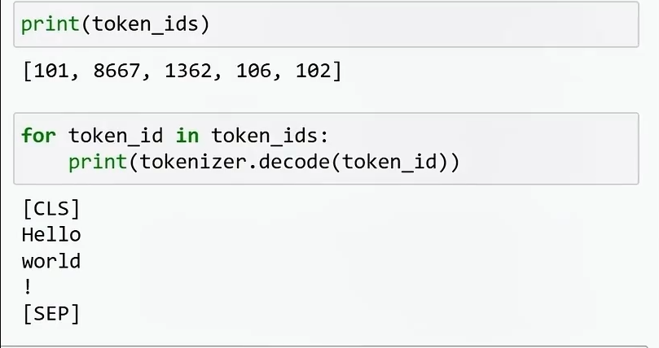

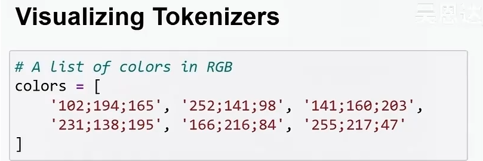

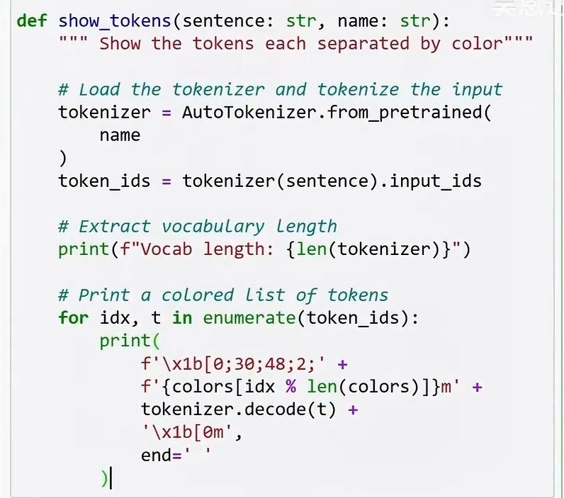

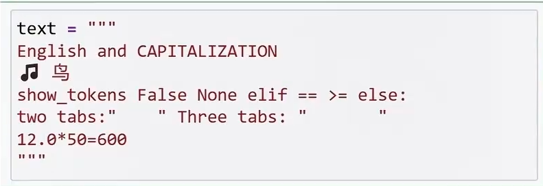
Note: This text contains all different types of words to showcase how different tokenizers will process this particular input.

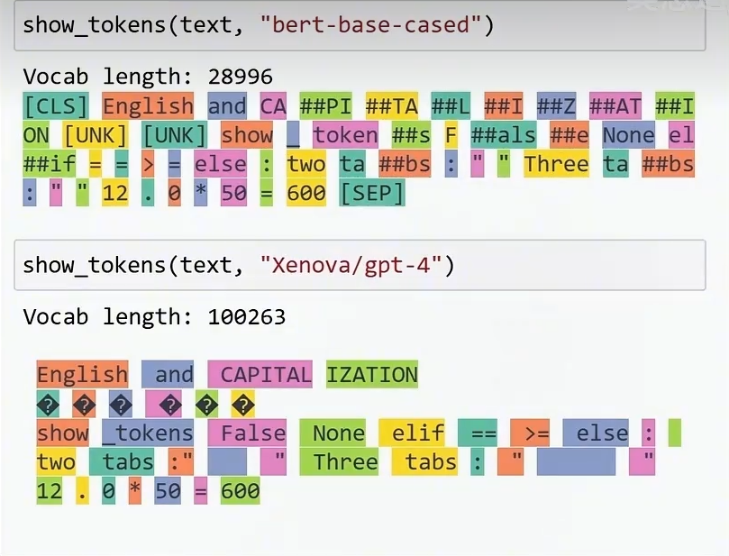
Look at the results of "bert-base-cased" tokenzier and "gpt-4" tokenizer carefully. The outputs contain 2 parts: vocabulary size and tokenization results. The gpt-4 tokenizer is meant for a generative representation, so it doesn't have the CLS and the SEP classification tokens.

# 18. Architecture Overview
An inportant thing to notice: Transformer LLMs generate their output one token at a time.
The transformer is made up of 3 major compoennts:Tokenizer, Stack of Transformer Blocks, LM Head.
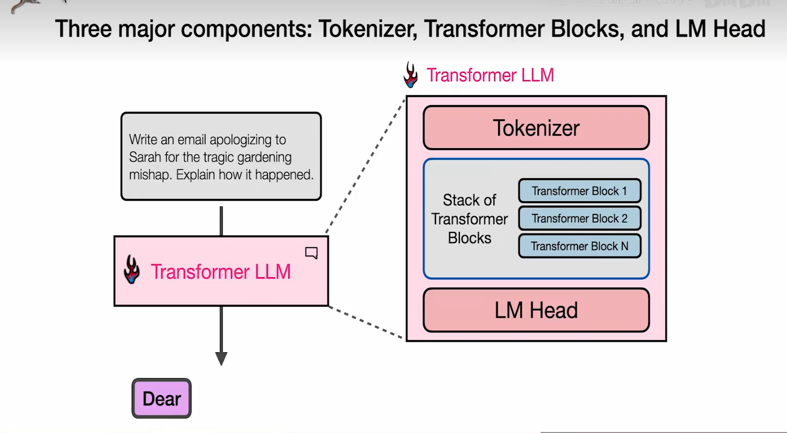
1. Tokenizer:
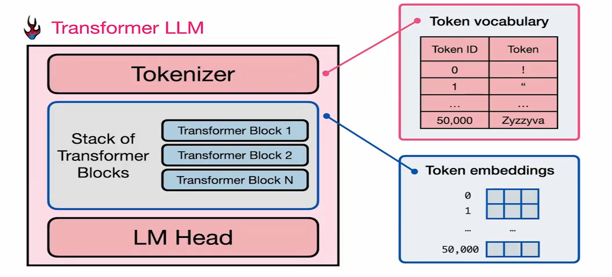
2. Stack of Transformer Blocks:  
We will talk about this in the next lesson.
3. LM Head:
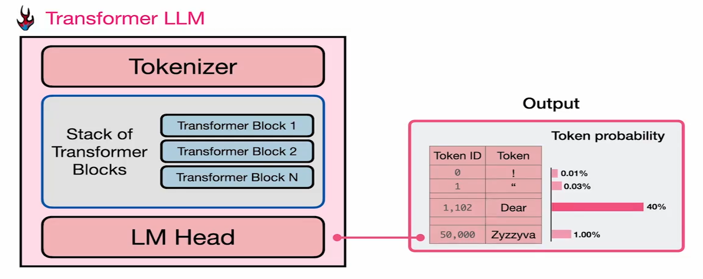
At the end of the processing of a language model, you will have all the tokens that you start with and that are defined in the tokenizer. What happened at the end is a kind of scoring or a token probabilty calculation based on the processing that the model in this stack of Transformer has done to make sense of the input context. You can choose the highest probability token and that is one method of choosing the next token. These are called decoding strategies.
You can choose the highest probabilty token as the nest token and it does work at most situation. This is called Greedy Decoding and correspond to temperature=0. You can also choose temperature>0, and choose top-k highest probablity tokens as the next token.
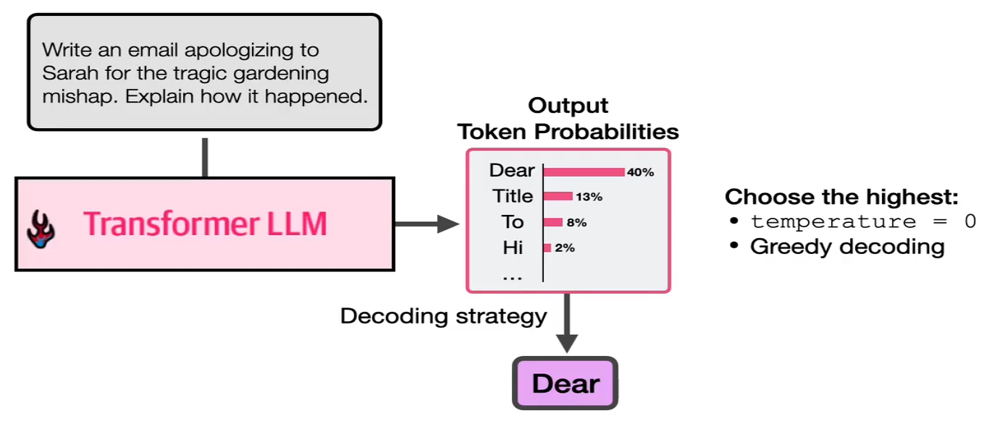

Compard with other language models, like RNN, transformer LLM has a graet adventage is that it can process all of their tokens in parallel and so that it has very high computation efficiency.  So you can compute a long text on a lot of GPUs in a similar time. The way to envision this is to think of multiple tracks flowing through the stack of transformer blocks.
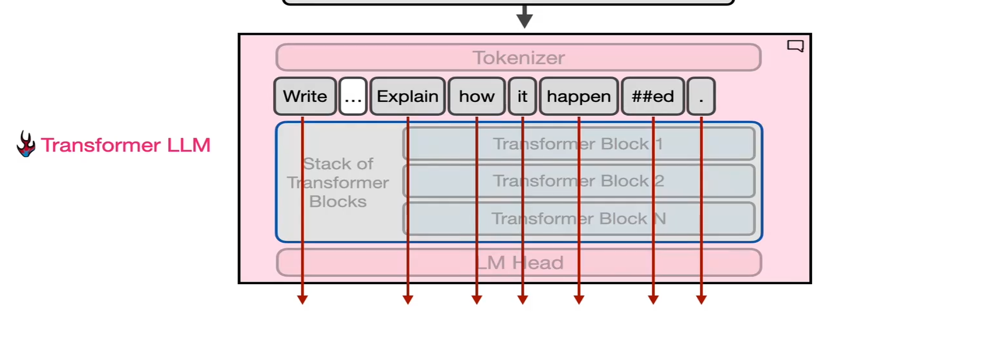
And the number of tracks here is the context size of the model.So if a model has a context size of 16000 tokens, this model can process 16000 tokens at the same time. The generated token in decoder-only LLM architectures is the output of the final token in the sequence. Once we've generated our first token, we feed the entire prompt with the generated token into the transformer again, so you can think this as a loop. When you process the inputs one by one as you generate these tokens, one thing that is different between the first step and the second step is that you can cache these calculations, because they're going to be exactly the same calculation. And you can cache them to speed up the generation of the model. This is what is called KV(Keys,values) caching. If you are working with efficiency, there this metric of time to first token. Time to first token, this is how long the model takes to process all of inputs. And then, generating each subsequent token is a slightly different process.
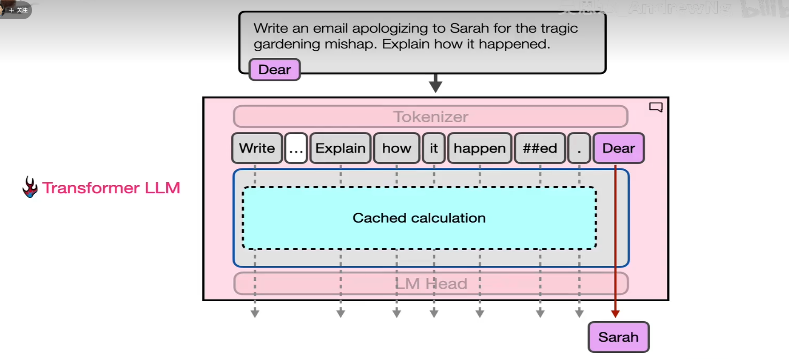

# 19. The Transformer Block
Data flow in transfoemer LLMs:
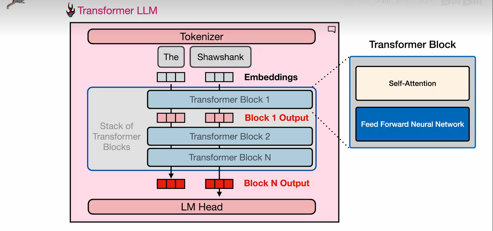

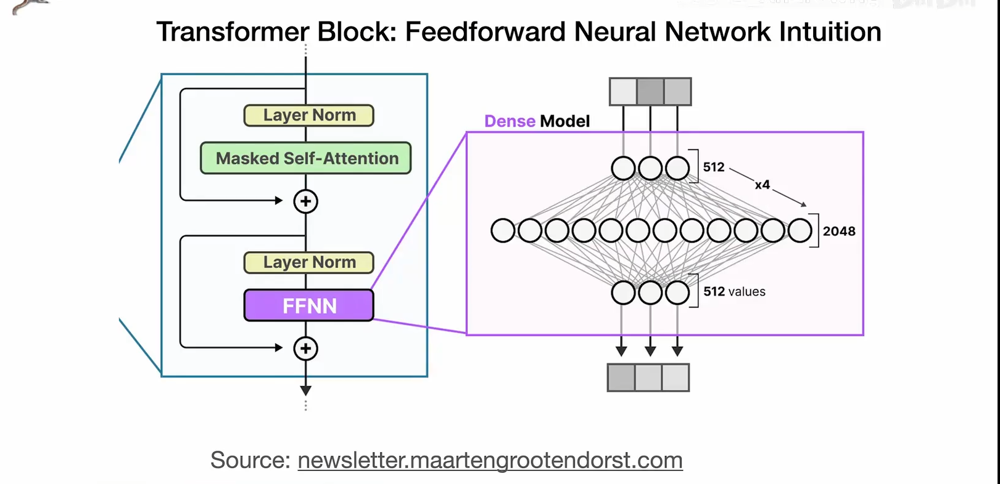

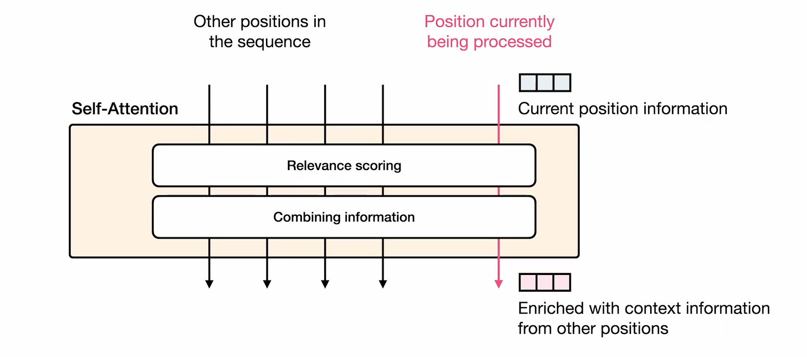

# 20. Self-Attention
Self-attention is a key component in the transformer block and it consists of 2 steps:  relevance scoring and then combining information. Self-attention happens within what we called an sttentiion head. let's assume that we use only one attention head to process self-attention.
Self-attention is conducted using three matrices, the query projection matrix, the key projection matrix and the value projection matrix. These weight matrices are used to calculate query、key、 value matrix. In these matrices(Q,K,V matrix), each row is a vector representing one position in the sequence.
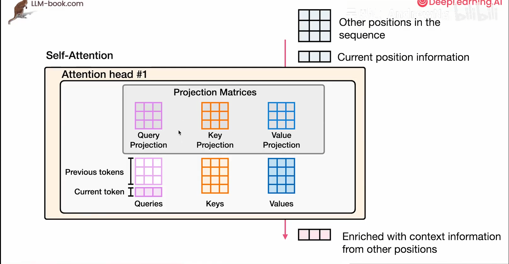

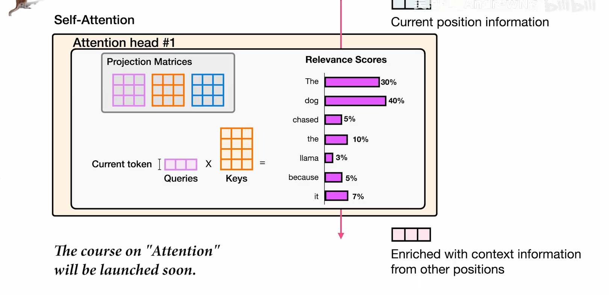
After we have the relevance scores, we can start the second step, which is combining the information from the relevant tokens. Detailed information is illustrated in the following picture.
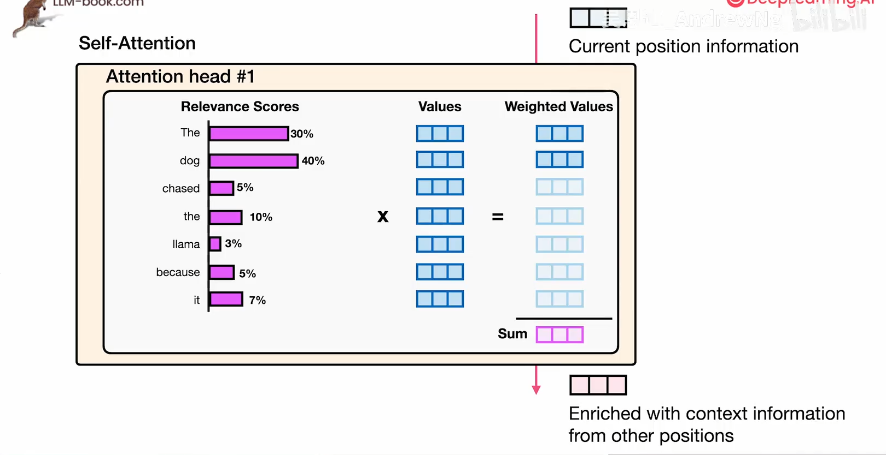

So far, we have been discussing one-head attnetion, next we will talk about multi-heads attention.

Each attention head has it's own set of Q,K,V projection matrices:
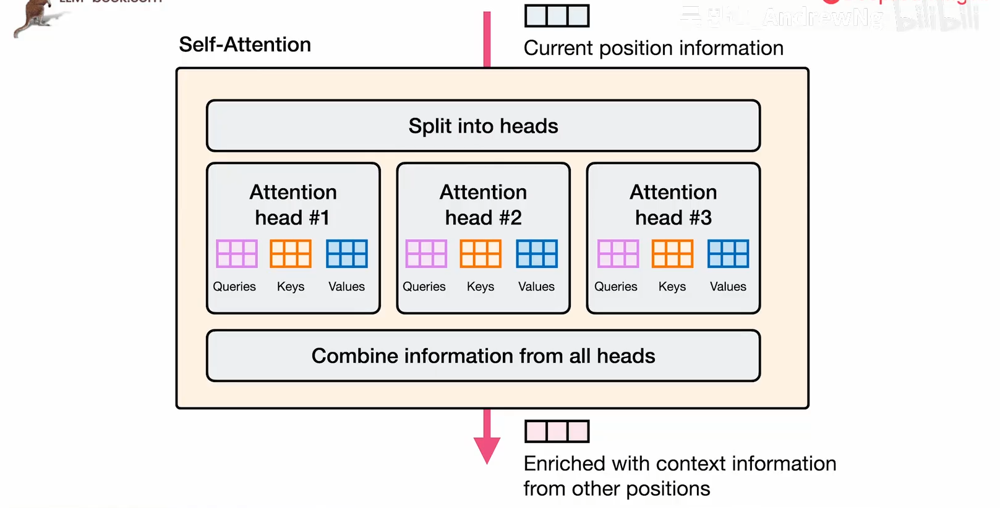

To make self-attention more efficient(This is usually one of the steps that takes the longest computational time in transformers), one idea is "multi-query" attention:(Through reducing the number of parameters to improve the computational efficiency.)
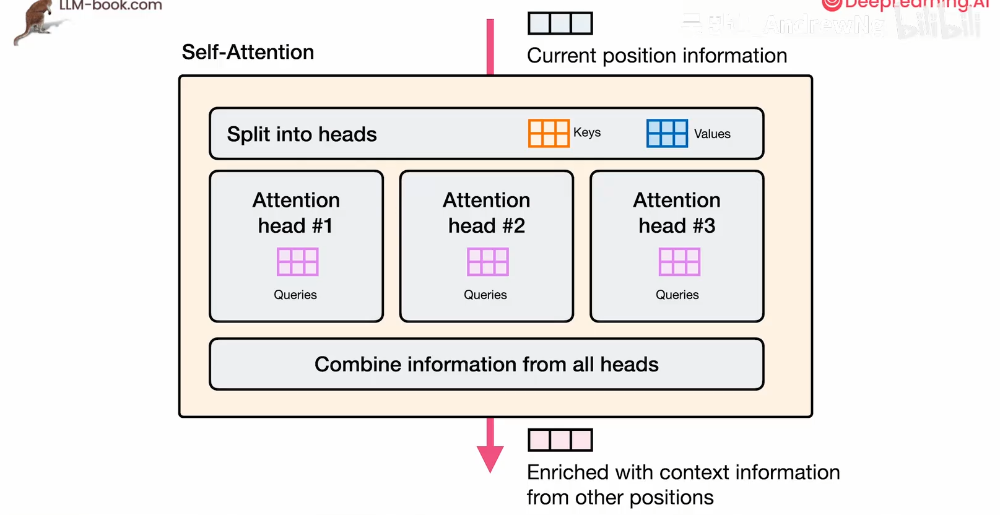

More recently, grouped-query attention is an efficient attention mechanism that allows us to use multiple keys and values not the same number as attention heads.
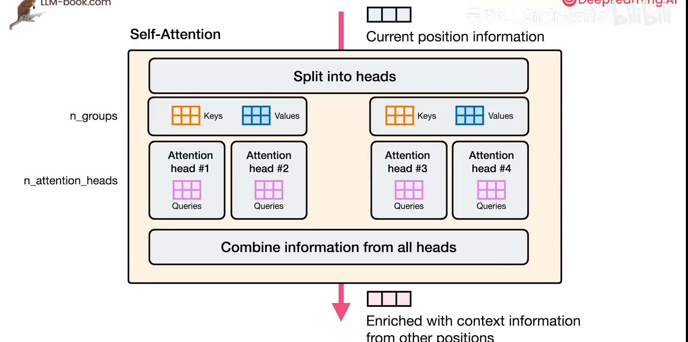

Another important recent idea for improving the efficiency of attention is sparse attention. And this usually not happen in all the layers.
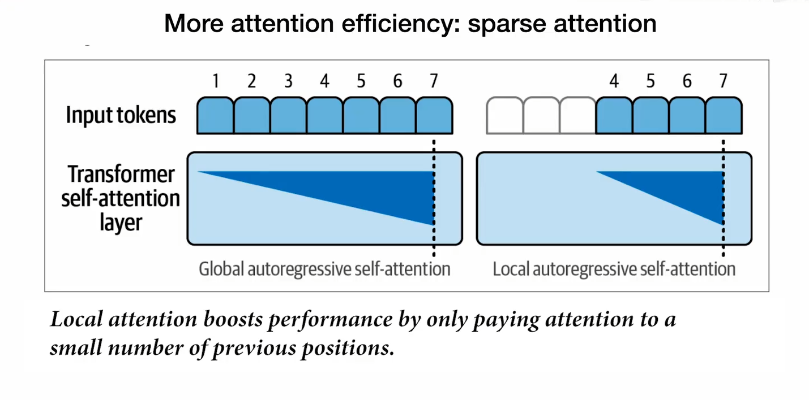

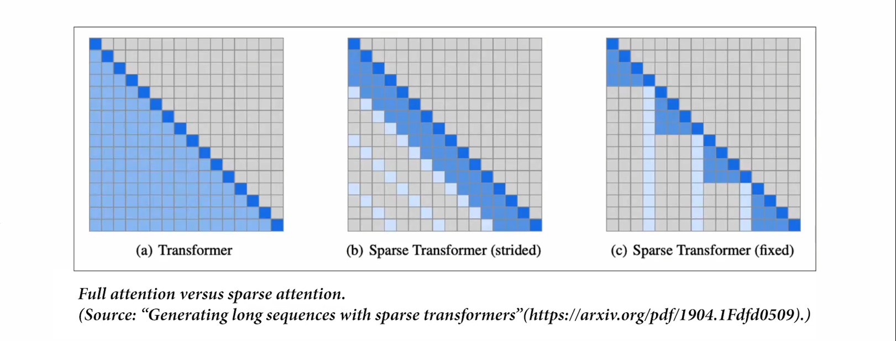
To allow the model to go through a hundred thousand or a million token context size, ring-attention came out.
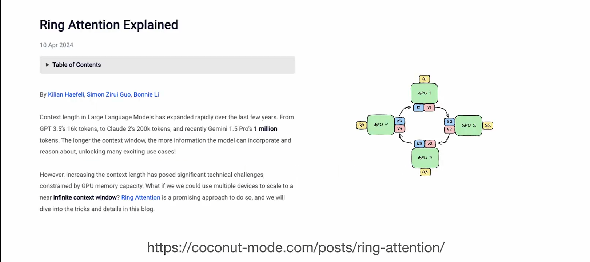

The illustration of Llama3's architecture:


# 21. Model Example
```python
from transformers import AutoModelForCausalLM, AutoTokenizer, pipeline

# Load model and tokenizer
tokenizer = AutoTokenizer.from_pretained("microsoft/Phi-3-mini-4k-instruct")
model = AutoModelForCausalLM.from_pretrained(
    "microsoft/Phi-3-mini-4k-instruct",
    device_map="cpu",
    torch_dtype="auto",
    trust_remote_code="True"
)

# create a pipeline
generator=pipeline(  #__call__方法使得类pipeline的实例对象可以被当做函数用
    "text-generation",
    model=model,
    tokenizer=tokenizer,
    return_full_text=False,
    max_new_tokens=50,
    do_sample=False #表示使用贪心解码策略
)

prompt="Write an email apologizing to sarah for the targic gardening mishap. Explain how it happened"

output=generator(prompt)
print(output[0]["generated_text"]) #这里是先索引列表，再索引字典。
```

Now Let we generate text in a different way. So instead of doing a pipeline, the pipeline sort of abstracted a few things from us. Let's do it in a way where we can get to see more mechnism of how the processing is actually down.
```python
prompt = "The capital of France is"

# tokenizer the input prompt
input_ids = tokenizer(prompt, return_tensors="pt").input_ids
model_output = model.model(input_ids)
model_output[0].shape
#torch.Size(1,5,3072)
# 1 is the batch dimension(Because we pass the model only one text)
# 5 is the number of tokens in the sequence
# 3072 is the dimensionality of the output vectors. THese vectors are before language model head.
lm_head_output= model.lm_head(model_output[0])
lm_head_output.shape
# torch.Size([1,4,32064])
# 32064 is the vocabulary size

token_id = lm_head_output[0,-1],argmax(-1)

# token_id= tensor(3681)
tokenizer.decoder(token_id)
# Pairs
```

# 22. Recent Improvment


We will talk about rotary embeddings. But before we do that, let's talk a little about training.
LLMs are trained in multiple steps. The first step is the base training, where iit's the next token prediction step. That's what called language modeling.

If training documents  is located as the first style in aboving picture, where the majority of the cotext window is just padding that is not really used. And this is an inefficient way to pack the training data. A more efiicient way of packing these docunmets is the second style in above picture.


One more recent development that you might have come across is the idea of mixture of experts. This is the concept that use sub-models to improve the quality of LLMs. But that's not to say that all LLMs are becoming a mixture of experts models.

# 23. Mixture of experts
In this lesson, we will learn two main components in the mixture of experts: the experts and the router. 
Original decoder block in transformer:


What are experts:

MIxture of experts is a technique that relates to the feed-forward neural network. Instead of a single network, it has several networks it can choose to use. Each network is called an expert.
Note that an expert is not specialized in a specific domain like psychology or biology. At most, it learns syntactic information on a token level, such as punctuation,verbs and conjunctions.

When the inputs flows through this exper layer, one or several experts are selected to process the input. ANd this will leave other experts unactivated. This called a sparse model,since only subset of experts are activated at a given time. 


A MoE layer consists of one or several experts, each a feed-forward neural network. But how do we know which input should go to which expert? This is where the router come in. Its main job is to choose which input should go to which expert. Like the expert, the router is a feed-forward neural network itself, but quite a bit smaller. For each input, the router creates a probabilty score to indicate how like it is that the expert is suited for the particular input. And than the router choose the expert based on the score. Choose the highest score is ok, but other straktegies exist that might introduce more creativity to the output. For example,you can choose several experts and aggregate their results(weighted mean).

A major benefit of mixture of experts is its computational requirement. Although having multiple experts rather than a single expert seemed like it only increase the computational requirements, it actually a bit more nuanced than that. The parameters of a model using mixture of experts can be found only in roughly five different places. When we load the model, we need to load all parameters. These are called sparse parameters, as not all of them are used currently. All experts are loaded, but only one or several of them are used. In contrast, the active parameters are those that are actually used to  run inference. As a result, the amount of memory needed to load  the model is high, but the amount of memory needed in inference is low(comparitively)


Let's explore this with an example and calculate the parameters of a model. The model that you will be exploring is Mixtral 8*7B. It's a model that has 8 experts and each expert has 7 billions parameters.

Note: We assume 2 experts are actived in inference.

There are a number of pros and cons of this architecture.(Note: Because the moe layer only affects FFNN and not the attention mechanism, non-transformer models can also have MoE layers. And this makes MoE an useful architecture in entire LLM space)
